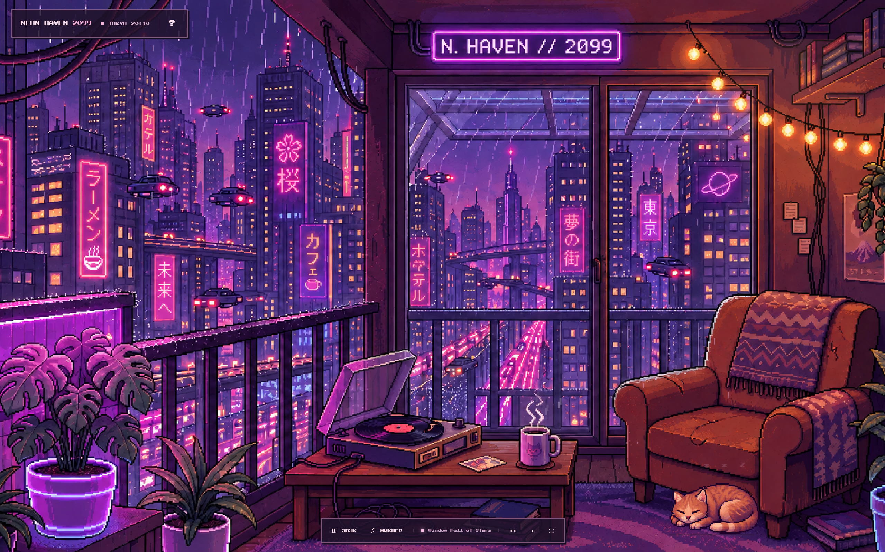

# Neon Haven 2099

Уютный интерактивный пиксельный балкон над ночным Токио. Дождь за окном, розово-фиолетовый неон, горячий чай, спокойная музыка и сонный кот — маленькое место, где можно выдохнуть.



## Что внутри

- Детальная 2D-пиксельная сцена с креслом, пледом, растениями и гирляндой.
- Кот с отдельными кадрами сна, пробуждения и лёгкого потягивания. Наведение, нажатие или фокус с клавиатуры вызывают реакцию; при включённом звуке он мурчит.
- Дождь только в видимых участках улицы за окнами; капли не перекрывают комнату.
- Летающие машины на нескольких маршрутах и отдельная анимация пара над кружкой.
- Интерактивные чай, проигрыватель и освещение.
- 12 оригинальных процедурных lo-fi-композиций с разными темпами и аранжировками, выбором пластинки и автоматической сменой.
- Независимая громкость дождя, города и музыки.
- Часы Токио, полноэкранный режим и отключение анимации; учитывается системная настройка уменьшения движения.

## Запуск

Проект состоит из HTML, CSS и JavaScript. Сборка, npm-зависимости, серверная часть и API-ключи не нужны.

Из папки проекта запустите локальный HTTP-сервер, например с Python 3:

```bash
python -m http.server 4173
```

Откройте [http://localhost:4173](http://localhost:4173).

HTTP-сервер нужен для корректной загрузки и обработки спрайтов. Не запускайте страницу двойным кликом через `file://`.

## Управление

| Элемент | Действие |
| --- | --- |
| «Войти на балкон» | Открыть сцену со звуком |
| «Войти без звука» | Открыть сцену в тишине |
| Кот | Навести указатель или нажать, чтобы разбудить и погладить |
| Кружка | Сделать виртуальный глоток чая |
| Проигрыватель / «Звук» | Включить или выключить аудио |
| Гирлянда | Переключить яркость сцены |
| «Микшер» | Выбрать пластинку и настроить громкость |
| ▸▸ | Следующая пластинка |
| ? | Показать интерактивные предметы |
| ≈ | Приостановить или возобновить анимацию |
| ⛶ | Полный экран, если поддерживается браузером |
| Escape | Закрыть микшер и скрыть подсказки |

Звук запускается только после действия пользователя — это ограничение браузеров. На телефоне используйте касание вместо наведения. Для полного обзора балкона удобнее горизонтальная ориентация.

## Структура

```text
index.html           Структура сцены и игровая панель
game.css             Оформление, адаптивность и эффекты
game.js              Взаимодействия, микшер и звук окружения
scene-effects.js     Дождь, движущиеся машины, пар и маски окон
music.js             12 процедурных музыкальных аранжировок
cat-sprite.js        Отрисовка и состояния кота
assets/
  balcony-static.png Фон без неподвижных кота, капель, машин и пара
  cat-poses.png      Три кадра кота на прозрачном фоне
docs/
  screenshot.png    Скриншот проекта
```

## Технологии и материалы

Vanilla JavaScript, Canvas 2D и Web Audio API. Музыка и мурчание синтезируются в браузере: внешних аудиофайлов и музыкальных стримингов нет. Графика создана с помощью генерации изображений по визуальному референсу. Шрифт **Press Start 2P** загружается через Google Fonts, поэтому для его загрузки требуется интернет.

## Размещение

Скопируйте содержимое репозитория на любой статический хостинг. Для GitHub Pages в настройках репозитория выберите **Pages → Deploy from a branch**, нужную ветку и папку **/ (root)**. Все пути к ресурсам относительные и подходят для публикации в подпапке репозитория.
